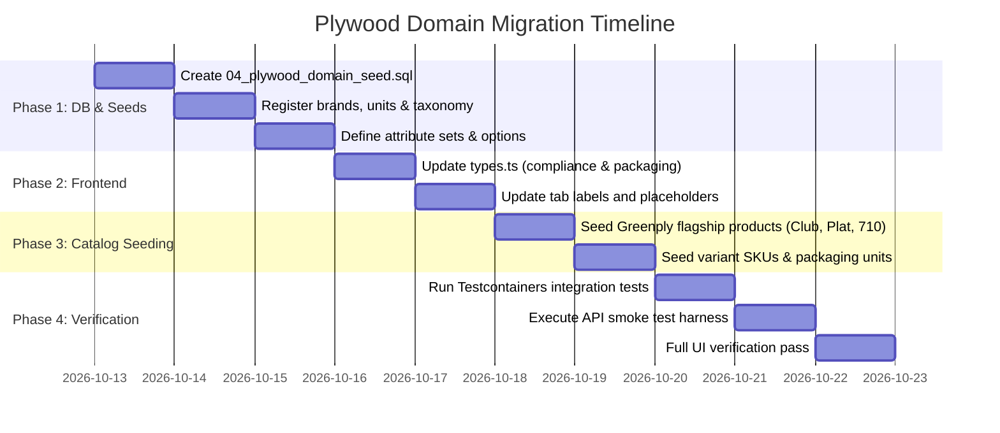

# PIM Platform — Domain Migration Plan: Ceramic Tiles to Plywood (Greenply Model)

> **Document Version**: 1.0  
> **Status**: Ready for Execution  
> **Target System**: PIM Platform (`services/catalog` + `frontend`)  
> **Reference Model**: [Greenply Industries Catalog](https://www.greenply.com/)

---

## 1. Executive Summary & Objective

The current `pim-platform` prototype was seeded with data from an architectural ceramics and tile manufacturer (*Agrob Buchtal* and *DryTile*), with tile-specific parameters such as glaze, slip resistance (R-values), grout joint widths, frost resistance, and abrasion classes.

This plan details the migration to the **Engineered Wood & Plywood domain**, adopting the industry taxonomy, technical specifications, compliance standards, and commercial models exemplified by **Greenply Industries Limited**.

### Core Architecture Advantage
Because `pim-platform` utilizes a **metadata-driven Clean Architecture** with a dynamic EAV (Entity-Attribute-Value) engine, **the core database schema and frontend UI components do not require structural rewrites**. The transformation is achieved by configuring the domain metadata:
- Updating taxonomy nodes and category hierarchies.
- Defining plywood attribute sets, groups, and typed attributes.
- Aligning compliance document types, measurement units, and application categories.
- Seeding plywood product families, SKUs, and packaging units.

---

## 2. Tab-by-Tab Domain Gap Analysis

### 2.1. General Tab
| Aspect | Current Tile Domain | Plywood Domain (Greenply) |
| :--- | :--- | :--- |
| **Brands** | `Agrob Buchtal`, `DryTile` | `Greenply` (Sub-brands: *Green Club*, *Green Platinum*, *Green 710*, *Green Gold*, *Green Ecotec*) |
| **Product Codes** | e.g. `FD-90-GS-1000` | E.g. `GP-CLUB-700`, `GP-PLAT-BWP`, `GP-710-MAR`, `GP-GOLD-BWP` |
| **Taxonomy Categories** | `floor_tiles`, `wall_tiles`, `patio_tiles`, `pool_edging_tiles` | `plywood_blockboard`, `flush_doors`, `decorative_veneers`, `pvc_wpc`, `mdf_boards` |

### 2.2. Attributes Tab (Dynamic EAV Engine)
| Current Tile Attributes (To Deprecate/Replace) | New Plywood Attributes (To Introduce) | Type & Unit |
| :--- | :--- | :--- |
| `glaze` (Glazed / Unglazed) | **`water_resistance_grade`** (`MR`, `BWR`, `BWP` / Marine) | `list` (enum) |
| `slip_resistance` (`R9`–`R13`, `A/B/C`) | **`emission_standard`** (`E0` ≤ 3mg/100g, `E1`, `CARB P2`, `EPA TSCA`) | `list` (enum) |
| `slip_displacement` (`V4`–`V10`) | **`core_timber_species`** (Gurjan, Eucalyptus, Hardwood, Poplar) | `list` (enum) |
| `joint_width_mm` (Grout joint mm) | **`resin_type`** (Unextended PF, Melamine Urea MUF) | `list` (enum) |
| `frost_resistant` (Boolean) | **`borer_fungus_proof`** (Vacuum Pressure Impregnation) | `boolean` |
| `rectified` (Calibrated tile edge) | **`calibration_technology`** (`Penta (5) Tech`, 4-Press Quad) | `list` (enum) |
| `wear_group` / PEI abrasion class | **`fire_retardant`** (2X Fire Retardant per `IS:5509`) | `boolean` |
| `pieces_per_m2` / `weight_per_m2` | **`density_g_cm3`** (Core density: `0.65 – 0.85`) | `measure` (`g/cm³`) |
| `nominal_size` (e.g. `60x60 cm`) | **`sheet_dimension`** (`8x4 ft` / `2440x1220 mm`, `7x4`, `8x3`, etc.) | `list` (enum) |
| *N/A* | **`thickness_mm`** (`4`, `6`, `9`, `12`, `16`, `19`, `25 mm`) | `measure` (`mm`) |
| *N/A* | **`moisture_content_pct`** (Standard `8% – 12%`) | `decimal` (`%`) |
| *N/A* | **`screw_holding_strength_n`** (Face/Edge screw holding load) | `number` (`N`) |
| *N/A* | **`warranty_years`** (`10`, `15`, `20`, `25`, `30`, `99` for Lifetime) | `number` (years) |
| *N/A* | **`money_back_multiple`** (`2X`, `7X` money-back guarantee) | `list` |

### 2.3. Variants Tab (SKUs)
* **Current Model**: SKUs represent format + color + surface structure.
* **Plywood Model**: SKUs represent **Sheet Dimensions × Thickness** combinations:
  - SKU `GP-C700-8X4-19MM`: Green Club 700, 2440 × 1220 mm, 19 mm thickness.
  - SKU `GP-C700-8X4-16MM`: Green Club 700, 2440 × 1220 mm, 16 mm thickness.
  - SKU `GP-PLAT-8X4-19MM`: Green Platinum BWP, 2440 × 1220 mm, 19 mm thickness.

### 2.4. Planning & BIM Tab
* **Current Model**: Tile frost resistance, slip coefficient, joint gaps.
* **Plywood Model**:
  - Structural engineering parameters: Modulus of Elasticity (MOE in N/mm²), Modulus of Rupture (MOR in N/mm²).
  - Fire reaction ratings and smoke generation index.
  - Thermal conductivity ($k$-value) and acoustic damping values.
  - 3D BIM/CAD objects: Standard sheet geometries, parametric panel thickness.

### 2.5. Classifications Tab
* **Current Standards**: ECLASS `22-22-01-01` (*Keramische Fliese / Ceramic tile*).
* **Plywood Standards**:
  - **ECLASS 14.0**: `22-27-01-01` (*Sperrholz / Plywood / Engineered Wood*).
  - **UNSPSC v26**: `30103603` (*Plywood*), `30103600` (*Wood and engineered wood*), `11122000` (*Timber*).
  - **ETIM 9.0**: Construction board and wood panel classifications.

### 2.6. Compliance Tab
* **Current Certifications**: Tile standard `EN 14411`, CE ceramic rules.
* **Plywood Certifications**:
  - `IS:710` — Specification for Marine Plywood (BWP Grade, 72h boiling test).
  - `IS:303` — Specification for Plywood for General Purposes (MR and BWR grades).
  - `IS:10701` — Specification for Structural Plywood.
  - `IS:5509` — Specification for Fire Retardant Plywood.
  - `IS:2202` — Specification for Wooden Flush Door Shutters.
  - `IS:1659` — Specification for Blockboards.
  - `CARB Phase 2` & `EPA TSCA Title VI` — Formaldehyde emission compliance (< 0.05 ppm).
  - `FSC` (Forest Stewardship Council) — Certified sustainable timber sourcing.
  - `IGBC / GRIHA` — Green Building Product Certifications.

### 2.7. Packaging Tab
* **Current Levels**: `EACH` (tile), `CARTON` (m² per box, pieces per box), `PALLET` (boxes per pallet).
* **Plywood Levels**:
  - `EACH`: 1 Sheet (e.g. 2440 × 1220 × 19 mm, net weight ~38 kg).
  - `BUNDLE / CRATE`: 20 to 50 sheets stacked with bottom wooden skids, strapped with steel/polyester bands and protective edge angles.
  - `PALLET`: Master export shipping container configuration.

### 2.8. Relationships Tab
* **Current Links**: Tile adhesive, grout, skirting, corner trims.
* **Plywood Links**:
  - `ACCESSORY` / `COMPATIBLE`: Decorative Veneers (*Wood Crrests*), High Pressure Laminates (HPL), Edge Banding Tapes, Wood Glues/Adhesives (D3/PF PVA).
  - `UP_SELL`: Upgrading from `Green Gold` (Commercial) to `Green Platinum` (Fire Retardant) or `Green Club 700` (Lifetime warranty).
  - `CROSS_SELL`: Flush Doors, WPC Panels, Hardware fittings.

### 2.9. Applications Tab
* **Current Options**: Wall, Floor, Pool edging, Terrace, Wet barefoot area.
* **Plywood Options**:
  - **Living & Bedroom**: Wardrobes, Bed bases, Wall Panelling, Study desks.
  - **Wet / Moisture Areas**: Modular Kitchen cabinets, Bathroom Vanities, Under-sink cabinetry.
  - **Commercial & Heavy Duty**: Partition walls, False ceilings, Office workstations.
  - **Specialized / Exterior**: Marine & Boat building, Fire-exit corridors.

---

## 3. Database Schema Migration Specification

A dedicated SQL migration script (`04_plywood_domain_seed.sql`) will be added to `services/catalog/db/init/`.

### 3.1. Brands & Taxonomy Nodes
```sql
-- Brand
INSERT INTO brand (code, legal_entity, website, country_code, status)
VALUES ('greenply', 'Greenply Industries Limited', 'https://www.greenply.com', 'IN', 'active')
ON CONFLICT (code) DO NOTHING;

INSERT INTO brand_tr (brand_id, locale_code, name, description, tagline)
SELECT b.id, 'en-GB', 'Greenply', 'India''s premier plywood and panel manufacturer', 'Zero Emission E0 Plywood'
FROM brand b WHERE b.code = 'greenply'
ON CONFLICT DO NOTHING;

-- Taxonomy Tree (using ltree)
-- ROOT.WOOD_PANELS
-- ROOT.WOOD_PANELS.PLYWOOD
-- ROOT.WOOD_PANELS.DOORS
-- ROOT.WOOD_PANELS.VENEERS
-- ROOT.WOOD_PANELS.PVC_WPC
```

### 3.2. Measurement Units
```sql
INSERT INTO unit (code, symbol, dimension) VALUES
  ('sqft',  'sq ft', 'area'),
  ('sqm',   'm²',    'area'),
  ('g_cm3', 'g/cm³', 'density'),
  ('mpa',   'MPa',   'pressure'),
  ('n',     'N',     'force'),
  ('hours', 'hrs',   'time')
ON CONFLICT (code) DO NOTHING;
```

### 3.3. Attribute Groups & Attributes
```sql
-- Groups: plywood_technical, plywood_dimensions, plywood_protection, plywood_health, plywood_commercial
INSERT INTO attribute_group (code) VALUES
  ('plywood_dimensions'),
  ('plywood_technical'),
  ('plywood_protection'),
  ('plywood_health'),
  ('plywood_commercial')
ON CONFLICT (code) DO NOTHING;

-- Attributes:
-- water_resistance_grade (list: MR, BWR, BWP)
-- emission_standard (list: E0, E1, CARB_P2, EPA_TSCA)
-- core_species (list: Gurjan, Eucalyptus, Hardwood, Poplar)
-- resin_type (list: Unextended PF, Melamine Urea MUF, Urea Formaldehyde UF)
-- sheet_dimension (list: 8x4 ft, 8x3 ft, 7x4 ft, 7x3 ft, 6x4 ft)
-- thickness_mm (measure, unit: mm)
-- borer_fungus_proof (boolean)
-- fire_retardant (boolean)
-- density_g_cm3 (measure, unit: g_cm3)
-- moisture_content_pct (decimal)
-- warranty_years (number)
-- money_back_multiple (list: None, 2X, 7X)
```

---

## 4. Frontend Adjustments

### 4.1. Compliance Document Types
Update [frontend/src/features/products/types.ts](file:///c:/Users/DELL/Downloads/pim-platform/frontend/src/features/products/types.ts#L281):

```typescript
// Replace current ceramic-only enum:
export const COMPLIANCE_DOC_TYPES = [
  'ISI',    // Bureau of Indian Standards (IS:710, IS:303, IS:10701, IS:5509)
  'FSC',    // Forest Stewardship Council (Chain of Custody)
  'CARB',   // California Air Resources Board E0 / Phase 2
  'EPA',    // EPA TSCA Title VI Formaldehyde
  'IGBC',   // Indian Green Building Council
  'TEST',   // Lab Test Report (72h Boiling / Borer resistance)
  'EPD',    // Environmental Product Declaration
  'CE',     // CE Marking
] as const;
```

And update labels in [ComplianceTab.tsx](file:///c:/Users/DELL/Downloads/pim-platform/frontend/src/features/products/ComplianceTab.tsx#L50-L57):
```typescript
const DOC_TYPE_LABEL: Record<string, string> = {
  ISI: 'ISI — Bureau of Indian Standards',
  FSC: 'FSC — Forest Stewardship Council',
  CARB: 'CARB Phase 2 (E0 Emission)',
  EPA: 'EPA TSCA Title VI',
  IGBC: 'IGBC Green Building Certified',
  TEST: 'Laboratory Test Report',
  EPD: 'EPD — Environmental Product Declaration',
  CE: 'CE Marking',
};
```

### 4.2. Packaging Terminology
Update [PackagingTab.tsx](file:///c:/Users/DELL/Downloads/pim-platform/frontend/src/features/products/PackagingTab.tsx#L29-L35):
```typescript
const LEVEL_LABEL: Record<string, string> = {
  EACH: 'Sheet (Individual piece)',
  INNER: 'Pack / Sub-bundle',
  CARTON: 'Banded Bundle / Crate',
  LAYER: 'Layer',
  PALLET: 'Pallet / Shipping Skids',
};
```

---

## 5. Phased Implementation Roadmap



### Phase 1: Database Seed Script (`04_plywood_domain_seed.sql`)
1. Create `services/catalog/db/init/04_plywood_domain_seed.sql`.
2. Add Greenply brand, taxonomy nodes (`ltree` paths), and units.
3. Add 14 plywood-specific attributes, attribute groups, and option tables.
4. Bind them into a default `plywood_attribute_set`.

### Phase 2: Frontend Types & Labels Alignment
1. Modify `COMPLIANCE_DOC_TYPES` in `frontend/src/features/products/types.ts`.
2. Update `DOC_TYPE_LABEL` in `ComplianceTab.tsx`.
3. Update `LEVEL_LABEL` in `PackagingTab.tsx`.
4. Ensure `placeholderFor` in `ClassificationsTab.tsx` supports sheet dimensions.

### Phase 3: Sample Product Ingestion (Greenply Showcase)
Seed 4 showcase products representing the complete product spectrum:
1. **`GP-CLUB-700`**: Green Club 700 Structural E0 Plywood (Lifetime warranty, 7X money back, IS:10701 & IS:710).
2. **`GP-PLAT-BWP`**: Green Platinum 2X Fire-Retardant BWP Plywood (30-year warranty, 2X money back, IS:5509).
3. **`GP-710-MAR`**: Green 710 Marine Plywood (Selected hardwood, 25-year warranty, IS:710).
4. **`GP-GOLD-BWP`**: Green Gold BWP Plywood (30-year warranty + 11-Year Fully Covered+ restoration plan).

Each product will have:
- 4–6 SKUs for standard thicknesses (`6mm`, `12mm`, `16mm`, `19mm`).
- Digital assets linked (technical datasheets, boiling test certificates, grain renders).
- Complete compliance documents (`IS:710`, `CARB Phase 2 E0`, `FSC`).
- Packaging hierarchy (`EACH` sheet → `BUNDLE` of 25 sheets).
- Applications tagged (`Kitchens`, `Wardrobes`, `Partitions`, `Wet Areas`).

### Phase 4: Verification & Quality Gate
1. Reset PostgreSQL database container to execute new init scripts:
   ```powershell
   cd infra
   docker compose down -v
   docker compose up -d
   cd ..
   ```
2. Run backend test suites:
   ```powershell
   dotnet test services/catalog/tests/Pim.Catalog.Application.Tests
   dotnet test services/catalog/tests/Pim.Catalog.Domain.Tests
   ```
3. Run frontend verification:
   ```powershell
   cd frontend
   npm test
   cd ..
   ```
4. Verify end-to-end functionality in the running browser at [http://localhost:5174/products](http://localhost:5174/products).

---

## 6. Definition of Done (DoD) Checklist

- [ ] Greenply brand and plywood taxonomy nodes appear in the Categories navigation tree.
- [ ] Product creation drawer allows selecting Plywood category and Attribute Set.
- [ ] Attributes tab shows plywood groups: *Dimensions*, *Technical*, *Protection*, *Health/Emissions*, *Commercial*.
- [ ] Variants tab manages SKUs based on Sheet Dimensions × Thickness.
- [ ] Compliance tab supports `ISI` standards (`IS:710`, `IS:303`, `IS:10701`, `IS:5509`) and `CARB / E0` certificates.
- [ ] Packaging tab displays sheet and bundle quantities instead of tile carton m².
- [ ] Applications tab allows toggling plywood use cases (kitchens, wardrobes, wet areas).
- [ ] All 397+ backend tests pass and 332+ frontend tests pass without regression.
